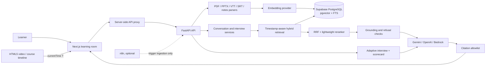

# Architecture

## Learning request path

1. The browser sends a question, course/session IDs, action and the current player time `T`.
2. FastAPI checks the session belongs to that course. The database query applies `source_type <> 'video' OR end_time <= T` before vector and full-text ranked candidates are formed.
3. Vector and keyword candidate ranks are combined with reciprocal rank fusion. FastAPI reranks at most 24 candidates and sends up to six passages (9,000 characters maximum) plus a small conversation window to the model.
4. If no allowed passage is retrieved, a second query checks future video metadata only. The future text is not returned to the app or passed to the model. The API refuses when the matching concept is ahead or absent.
5. Citations are constructed from retrieved chunk metadata only. Video references carry seek seconds; PDF and PPT references retain page/slide numbers.

Summary and quiz actions take a bounded sample of at most eight currently covered chunks, still filtered at the database boundary. This avoids sending a full transcript.

## Storage and embedding

`chunks.embedding` is `vector(1024)` across embedding providers. `local` uses deterministic feature hashing for zero-key demos, not a semantic model. Configure OpenAI `text-embedding-3-small`, Gemini `gemini-embedding-2`, or Bedrock Titan embeddings when semantic recall is required. Use the same provider/model settings for ingestion and query embedding. Embedding spaces are model-specific; re-embed every chunk after changing embedding model or dimensions.

## Scaling boundaries

- PostgreSQL handles persistent courses, chunks, vector similarity and FTS. HNSW and GIN indexes are included.
- `asyncpg` uses a bounded pool. Resource parsing runs in a threadpool; hosted ingestion can be moved to a queue when course uploads become large.
- The local rate limiter is per API process. Put Cloudflare, API Gateway, ALB/WAF or another shared limiter in front of multiple API replicas.
- The demo supports a global optional bearer key. Multi-tenant production should validate Supabase/LMS JWTs and use user/course ownership in API queries; RLS is included as a starting point.
